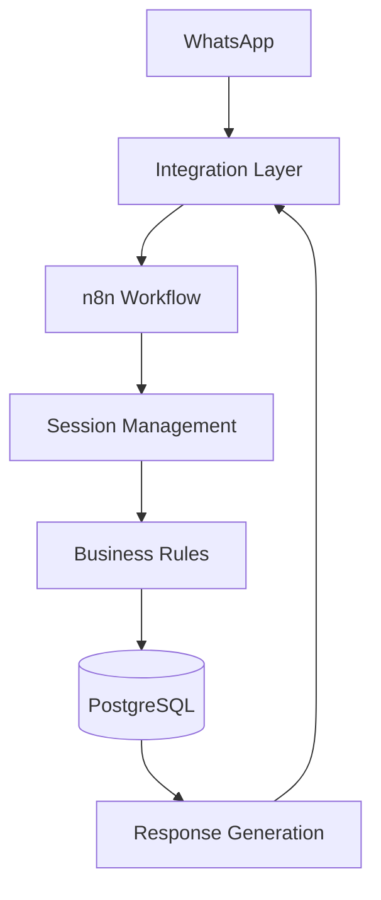
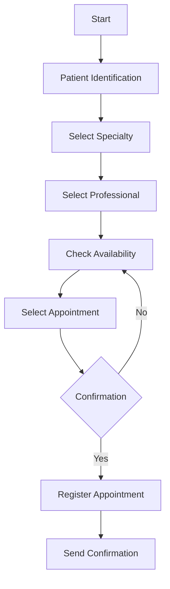

<h1 align="center">WhatsApp Appointment Automation</h1>

  Healthcare Scheduling System | VHC Soluções

  

---

## Overview | Visão geral

Sistema de automação de atendimento e agendamento
de consultas, desenvolvido para clínicas e consultórios.

O projeto tem como objetivo reduzir atividades
administrativas manuais, organizar agendamentos
e automatizar interações com pacientes.

The system focuses on workflow automation, database
integration, session management and healthcare scheduling.

---

## Tech Stack

---

## Functional Scope

| Feature | Description |
|---|---|
| Patient Management | Identificação e cadastro de pacientes |
| Specialties | Consulta de especialidades médicas |
| Scheduling | Agendamento de consultas |
| Availability | Consulta de horários disponíveis |
| Cancellation | Cancelamento e liberação de horários |
| Session Management | Controle do estado do atendimento |
| Business Rules | Validação das operações |

---

## System Architecture

Diagrama conceitual e simplificado da arquitetura
proposta para integração com o WhatsApp.

---

## Scheduling Workflow

---

## Engineering Principles

- Workflow orchestration
- State management
- Relational database modeling
- SQL queries and data validation
- Business rule implementation
- System integration
- Error handling
- Data consistency

---

## My Responsibilities

- Planejamento e arquitetura da solução.
- Desenvolvimento de fluxos automatizados.
- Modelagem de bancos de dados relacionais.
- Desenvolvimento de consultas SQL.
- Implementação de regras de negócio.
- Gerenciamento de sessões de atendimento.
- Testes e validação de fluxos operacionais.
- Diagnóstico e correção de falhas.
- Desenvolvimento assistido por inteligência artificial.

---

## Project Status

- Current stage: Active development
- Environment: Local development
- Scheduling and cancellation workflows: Implemented
- WhatsApp production integration: Pending
- Source code: Private

---

## Confidentiality

Este repositório possui finalidade exclusivamente
demonstrativa e profissional.

O código-fonte, os workflows proprietários,
as credenciais e os dados de pacientes não são
disponibilizados publicamente.

---

## Author

**Victor Hugo Motta Terraciano**

Software Developer & Co-founder at VHC Soluções

[GitHub Profile](https://github.com/zzovittin) |
[Company Website](https://vhcsolucoes.com.br)
